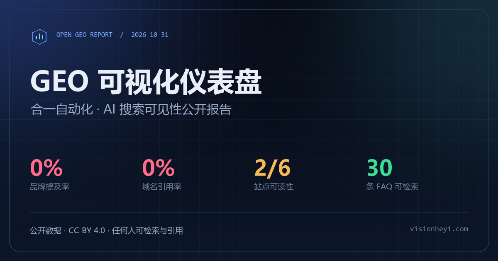

# GEO 可视化仪表盘 · 开放版

把一次完整的生成式引擎优化（GEO）检测，做成**公开、可检索、可复用**的静态站点：5 个工业视觉核心问题的 AI 搜索快照、站点机器可读性审计、40 条 FAQ 知识库、GEO 术语表、行业场景对比、开放数据下载，以及一个可接受访客建议并公开修订记录的反馈闭环。

🌐 **线上地址：https://makabk-wang.github.io/geo-dashboard/**（GitHub Pages 自动部署 · 永久地址）
🗂️ **仓库：https://github.com/MAKABK-wang/geo-dashboard**（代码 MIT · 数据 CC BY 4.0）



## 页面里有什么

- **公开数据**：品牌提及率 0%（0/5）、域名引用率 0%（0/5）、站点可读性 2/6，全部指标给出判定方式与局限。
- **关键发现**（v1.1.0 新增）：从原始回答中提炼 4 条核心结论，一眼看清问题所在。
- **竞品出现频次**（v1.1.0 新增）：18 个竞品在 5 个问题中的被推荐次数与跨场景分布，揭示“多场景重复”的权威建立规律。
- **路线图进度**（v1.1.0 新增）：五步计划标注已完成 / 进行中 / 未开始，并显示完成度。
- **全文检索**：`Ctrl/Cmd + K` 或 `/` 聚焦搜索，覆盖指标、检测问题、竞品、审计项、路线图、渠道、FAQ 与 AI 原回答；支持 `?q=` 深链。
- **40 条 FAQ**：四大分类、可展开、可复制答案与链接，并输出 FAQPage JSON-LD。
- **GEO 术语表**（v1.2.0 新增）：12 个核心概念，每条附「自查」判断标准，支持关键词筛选。
- **行业场景对比**（v1.2.0 新增）：锂电 / 3C / 汽车零部件 / 半导体四行业的检测对象、难点与方案要点。
- **机器可读**：`index.md`、`llms.txt`、`sitemap.xml`、`robots.txt`、Schema.org JSON-LD、开放 JSON 数据。
- **建议闭环**：访客提交建议 → 审核队列 → 采纳后修改数据、重新构建、部署，并把结果写进「建议与修订」。访客**只能建议，不能修改**：公开层是只读的，页面变更只能由维护者本机执行（详见 [SECURITY.md](SECURITY.md)）。
- **轻量**：无框架、无 CDN、无构建依赖（仅 Python 标准库），暗/亮主题、响应式布局、打印样式与基础无障碍支持。

## 快速开始

需要 Python **3.10+**。

```bash
# 1. 重新生成静态页面（数据、Markdown、llms.txt、robots、FAQ Schema）
python scripts/build.py

# 2. 本地预览（含建议提交 API）
python scripts/serve.py
# 打开 http://127.0.0.1:8123/
```

常用参数：

```bash
python scripts/build.py --base-url https://geo.example.com/   # 写入 canonical / OG URL / sitemap
python scripts/build.py --check                               # CI 校验生成文件是否最新
python scripts/serve.py --port 8080 --host 0.0.0.0            # 局域网或自托管
python scripts/make_assets.py                                 # 重新生成社交封面（需 Pillow，可选）
```

## 公开部署

### A. GitHub Pages（推荐，零成本）

1. 新建一个**公开**仓库，把本目录全部文件上传或推送。
2. 仓库 **Settings → Pages → Build and deployment → Source** 选择 **GitHub Actions**。
3. 推送到 `main` 后，`.github/workflows/pages.yml` 会自动用 Pages 地址构建并发布。
4. 打开 **Issues**，创建标签 `suggestion`，让纯静态托管下的建议反馈进入公开 Issue。
5. 把 `data/geo-report.json` 里的 `site.repo_url` 改成仓库地址（例如 `https://github.com/your-name/geo-dashboard`），重新构建并提交：

```bash
python scripts/build.py
```

> 建议在页面正式公开前，把 `site.base_url` 设为最终域名并执行一次构建，或在 Actions 中由 `actions/configure-pages` 自动注入。仓库内提交的版本可以保持为空，部署时由工作流覆盖。

### B. Netlify / Cloudflare Pages（拖拽上传）

- 构建后把整个目录拖到 Netlify Drop 或 Cloudflare Pages 的 Direct Upload。
- 纯静态托管没有 `/api/suggestions`，建议表单会自动回退为 **GitHub Issue**；请先设置 `site.repo_url`。
- 若使用自定义域名，把 `site.base_url` 设为该域名并重新构建，才能生成 canonical 与 sitemap。

### C. 自托管（建议 API 可用）

```bash
python scripts/serve.py --host 127.0.0.1 --port 8123
```

前面放 Nginx/Caddy 做 TLS 与限流。建议写入 `GEO_SUGGEST_DIR`（默认在仓库上一级的 `.geo-suggestions/`），不要放进 Web 根目录。该服务器是轻量开发/小流量服务，不建议直接暴露在高流量公网环境。

## 建议如何被接受与执行

### 提交

- **本地/自托管**：页面右上角「提建议」→ 表单 → `POST /api/suggestions`，返回回执编号。
- **纯静态托管**：表单自动改为带预填内容的 GitHub Issue（需设置 `repo_url`），建议公开可追踪。
- 建议类型：数据修正、内容补充、体验问题、其他。数据类建议请附来源链接。

### 审核与执行

**线上站点（GitHub Pages）的建议都进 GitHub Issue（`suggestion` 标签），运营者用 `operate.py` 全权处理：**

```bash
python scripts/operate.py issues                    # 列出待处理建议
python scripts/operate.py show 3                    # 查看 Issue #3 全文
python scripts/operate.py accept 3 \
  --title "补充 2D/3D 视觉选型对比" \
  --summary "在 FAQ 中新增对比表，并标注适用场景与来源。" \
  --version 1.1.0                                     # 采纳:记录+重建+推送+关闭 Issue
python scripts/operate.py reject 3 --reason "缺少可核对的来源"  # 不采纳
python scripts/operate.py push "更新说明"            # 普通内容更新:构建+提交+推送
```

- `accept` 会：写入公开记录 → `build.py` 重建 → 提交 → 推送 → GitHub Actions 自动重新部署 → 在 Issue 回复并关闭。全程一条命令，全权运营。
- 凭据读取顺序：环境变量 `GEO_GITHUB_TOKEN` → 仓库同级 `.tools/gh-token.txt`（本机文件，永不进仓库）。
- **本地预览模式**（`serve.py`）仍用私有收件箱，命令为 `suggestions.py`：

```bash
# 本地/自托管模式
python scripts/suggestions.py list
python scripts/suggestions.py show SUG-20261111-101500-AB12
python scripts/suggestions.py accept SUG-... \
  --title "补充 2D/3D 视觉选型对比" \
  --summary "在 FAQ 中新增对比表，并标注适用场景与来源。" \
  --version 1.1.0
python scripts/suggestions.py reject SUG-... --reason "缺少可核对的来源"
```

采纳后仍需完成实际修改：

1. 编辑 `data/geo-report.json`、`templates/index.html` 或 `assets/`；
2. 必要时提升 `data/geo-report.json` 的 `version`；
3. `python scripts/build.py`；
4. 检查页面、提交并部署。

「建议与修订」区块读取 `data/accepted-suggestions.json`，公开标题、摘要、来源说明与版本号；**联系人、IP 哈希、拒绝理由不会公开**。审核标准、隐私与时效说明见 [docs/REVIEW.md](docs/REVIEW.md)。

> 本项目由维护者与 AI 助手按同一标准评审建议；所有采纳结果公开可审计，页面会随建议直接更新。

## 数据与更新

`data/geo-report.json` 是唯一内容源，包含：

| 字段 | 用途 |
|---|---|
| `site` | 标题、描述、canonical 基地址、仓库地址、许可与关键词 |
| `brand` | 品牌、别名、域名、地址与定位（用于 JSON-LD） |
| `snapshot` | 数据采集/发布日期、方法说明、旧版计数勘误 |
| `kpis` / `queries` / `audit` | 指标、5 个检测问题与原始 AI 回答、6 项审计 |
| `assets` / `roadmap` / `channels` / `risks` | 内容资产、路线图、国内 AI 检索地图、风险 |
| `glossary` / `industries` | GEO 术语表与行业场景对比 |
| `faq` | 40 条问答及分类 |
| `method` / `changelog` | 指标定义、检测步骤、局限、引用格式、版本记录 |

检测工具（`geo_monitor.py`、`site_audit.py` 等）在原始工作区中运行，产出新的 `geo_report.json` 后，人工把结果合入本仓库的 `queries` 与 `audit`，再执行构建。Git 历史保留了每次快照的差异。

## 目录结构

```text
geo-dashboard/
├─ index.html                  # 生成：可直接部署的页面
├─ index.md                    # 生成：Markdown 全文镜像
├─ llms.txt                    # 生成：面向大模型的站点说明
├─ robots.txt / sitemap.xml    # 生成：抓取与索引
├─ assets/                     # 样式、交互、图标、社交封面
├─ data/
│  ├─ geo-report.json          # 唯一内容源
│  ├─ accepted-suggestions.json # 公开的已采纳建议
│  └─ faq-schema.json          # 生成：FAQPage JSON-LD
├─ templates/index.html        # 页面模板
├─ scripts/
│  ├─ build.py                 # 静态构建 + 校验
│  ├─ serve.py                 # 预览服务器 + 建议 API
│  ├─ suggestions.py           # 本地审核队列 CLI
│  ├─ operate.py              # 线上运营 CLI(处理 GitHub Issue 建议)
│  └─ make_assets.py           # 可选的封面生成脚本
├─ docs/REVIEW.md              # 建议审核与隐私政策
├─ SECURITY.md                 # 安全模型与公网实测记录
└─ .github/workflows/pages.yml # GitHub Pages 自动部署
```

## 机器可读与检索优化

- 页面首屏即包含完整正文，不依赖 JS 渲染；搜索、筛选、主题切换为渐进增强。
- `WebSite` + `SearchAction` 指向 `?q={search_term_string}`；页面内搜索会同步 `?q=` 深链。
- `WebPage`、`Dataset`、`Organization`、`FAQPage` 组成 JSON-LD `@graph`。
- `llms.txt` 列出核心事实、开放数据与 Markdown 镜像；`robots.txt` 明确欢迎主流 AI 检索代理。
- `sitemap.xml` 与 canonical 仅在设置 `base_url` 后生成，避免把示例域名写进线上页面。

## 许可与引用

- **代码**（构建脚本、模板、样式、交互）：[MIT](LICENSE)
- **数据与文字**（报告、FAQ、JSON 数据）：[CC BY 4.0](DATA-LICENSE.md)

引用时请保留来源与快照日期（2026-10-31）。页面「方法、许可与数据」提供可复制的引用文本与 BibTeX。

## 免责声明

AI 回答会随模型版本、时间和联网结果变化；站点审计结论也会随页面改版失效。本页是历史快照，不构成商业排名、投资建议或采购建议。品牌名称与商标归各自权利人所有。
